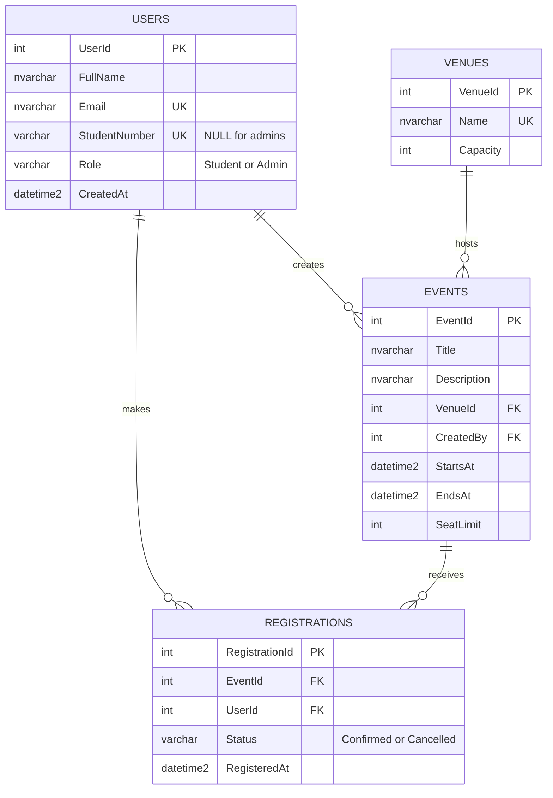

# Group Hands-On Laboratory Examination: SUBMISSION

**Project:** Online Campus Event Management System (prototype)

## 1. Team Roster

| Member | Name | Assigned Role | Core Responsibilities |
|---|---|---|---|
| Member 1 | Ruth Ma. Eunice Castillo | Systems Architect & Prompt Lead | Task 1 (Requirements & Prompt Engineering), Task 5 (Documentation & Integration) |
| Member 2 | Alessandra Nicole Añonuevo | Frontend Engineer | Task 2 (AI-Assisted UI & WCAG Accessibility) & Task 4 (Unit Testing & Vulnerability Refactoring)  |
| Member 3 | Tom Tan | Database & Backend Engineer | Task 3 (3NF Schema, Mermaid.js ERD, SQL script) |

## 2. Setup Instructions

**Repository layout**

```text
/frontend/            Task 2: index.html, register.html, attendees.html, styles.css, app.js
/database/schema.sql  Task 3: SQL Server (T-SQL) schema
/backend/             Task 4: RegistrationService.cs (fixed), RegistrationValidator.cs
/tests/               Task 4: xUnit + Moq unit tests
/SUBMISSION.md        this report
```

**View the website (no install, no server)**

1. Clone or unzip the repository.
2. Open `frontend/index.html` in any modern browser.
3. Use the top navigation to move between the three pages:
   - **Events** (`index.html`): browse upcoming events. Press **Register** on a card to go to the form with that event selected.
   - **Register** (`register.html`): choose an event, enter your name, student number and a `@univ.edu.ph` email, then press **Register**. A popup in the center confirms that you are registered.
   - **Admin** (`attendees.html`): view summary numbers, choose an event, search and remove attendees, and export a CSV per event. The prototype has no login; a production system would need server-side authentication.
4. Registrations are saved in the browser's `localStorage`, so they persist across the three pages. To reset, clear the site data for the page in your browser.

**Create the database (optional, needs SQL Server)**

1. Open `database/schema.sql` in SQL Server Management Studio, or run `sqlcmd -S localhost -i database/schema.sql`.
2. The script creates the `CampusEvents` database with the tables `Users`, `Venues`, `Events` and `Registrations`, their constraints and indexes.

**Run the unit tests (optional, needs the .NET 8 SDK)**

```text
dotnet test tests/CampusEvents.Tests.csproj
```

---

## Task 1: Requirements Analysis & Prompt Architecture

### Exact Prompt (RCTC)

```text
ROLE
You are a Lead Systems Architect with 15 years of experience designing small web
systems for universities. You give practical, time-boxed designs that a student
team can actually finish.

CONTEXT
A team of 3-4 fourth-year BSIT students (beginners with generative AI tools) has
exactly 3 hours to build a working prototype of an Online Campus Event Management
System. Students must be able to view upcoming campus events and register for an
event. Administrators must be able to view the registered attendees of an event.
The website is split into three separate pages: Events, Register, and Attendees.
The deliverable is one GitHub repository with frontend code, database scripts,
unit tests, and a backend C# method that reads registrations from SQL Server.

TASK
Produce an overall system design containing:
1. Functional and non-functional requirements (short bullet lists)
2. A layered architecture (frontend, backend, database) and what each layer does
3. The main pages/modules and how they interact
4. The core data entities and their relationships
5. A division of work for a 4-person team with a rough time budget per module
6. The top 3 delivery risks and how to reduce them

CONSTRAINTS

- Keep the design buildable in 3 hours by beginners; prefer simple over clever.
- Frontend: semantic HTML5, CSS, and vanilla JavaScript only.
- Backend: C# (.NET) with SQL Server.
- Do not use third-party state management libraries like Redux.
- Do not propose microservices, message queues, Docker orchestration, or any
  cloud-specific services.

- Do not include authentication providers (OAuth/SSO); a simple role field
  (Student/Admin) is enough for the prototype.

- Maximum 600 words. Use headings and bullet points. Do not write code.
```

### AI Output

**1. Requirements**

*Functional:* students view upcoming events; students register with a university email (`@univ.edu.ph`); the system rejects duplicate registrations and registrations beyond seat capacity; admins view the attendee list per event.
*Non-functional:* WCAG-accessible UI (semantic HTML, labels, contrast, keyboard use); secure data access (parameterized queries, no leaked connections); 3NF database with foreign key indexes; unit-tested validation logic.

**2. Architecture (3 layers)**

- **Presentation:** static HTML/CSS/vanilla JS split into three pages sharing one stylesheet and one script: Events (catalog), Register (form), Attendees (admin table).
- **Application:** C# service classes: `RegistrationService` (data access) and `RegistrationValidator` (email-domain and seat-availability rules).
- **Data:** SQL Server with `Users`, `Venues`, `Events`, `Registrations`.

**3. Pages and interaction**

Events page → "Register" button opens the Register page with the event preselected → validation (email domain, duplicate, seats) → registration saved → Attendees page reads the saved registrations per event.

**4. Entities**

`Users 1─* Registrations *─1 Events *─1 Venues`; `Users 1─* Events` (creator).

**5. Work division and time**

- Member 1: requirements, prompts, documentation (30 + 15 min)
- Member 2: frontend and accessibility (45 min)
- Member 3: schema, ERD, SQL script (45 min)
- Member 4: unit tests, security refactor (45 min)

**6. Top risks**

1. Scope creep (login, payments): freeze scope to the three user stories.
2. Merge conflicts: one folder per member; commit small and often.
3. Trusting AI output blindly: each member records at least one verification-log entry.

### Manual Grounding Evaluation

The architecture is realistic for a 3-hour prototype because it uses three layers, vanilla HTML/JS, and only four database tables, with no microservices, cloud services or external login. The roughly 45 minutes per member matches the exam's own task allocation. The one unrealistic assumption is a live connection between the browser pages and the C# layer, since building and hosting an API would not fit in the time. We therefore kept the website on `localStorage` shared across its three pages, and demonstrated the backend through the fixed `RegistrationService`, the validator, and its unit tests.

---

## Task 2: AI-Assisted Frontend Development

**Prompt used:**

```text
Build a modern, multi-page prototype for a campus event system using semantic HTML5
(header, nav, main, section, article, aside, footer) instead of generic div wrappers,
plain CSS and vanilla JavaScript only. Do not put everything on one page. Make three pages:
(1) Events: a hero and event cards with image, date badge, title, venue, a short description, the speaker and seats left, plus a how-it-works section;
(2) Register: a form with event dropdown, full name, student number and university email
(@univ.edu.ph), plus a summary of the selected event; (3) Admin: summary cards, search, remove and CSV export per event; add illustrated images.
Follow WCAG POUR: aria-label on inputs, a visible <label> for every field, color contrast
of at least 4.5:1, alt text on every image, a skip link, visible keyboard focus, and
aria-current on the active navigation link.
```

**Output:** committed to `/frontend`:

- `index.html`: Events page (hero + catalog)
- `register.html`: registration form + selected event summary
- `attendees.html`: admin attendee table
- `styles.css`, `app.js`: shared styles and logic
- `images/`: hero and event illustrations (SVG)

**Requirement checklist**

| Requirement | Where it is met |
|---|---|
| Semantic tags `<header>`, `<main>`, `<section>`, `<article>`, `<footer>` | All pages use them, plus `<nav>` and `<aside>`; event cards are `<article>` elements |
| `aria-label` on input fields | Event select, full name, student number, email, and the admin event select and search |
| Proper form labels | Every field has a `<label for="...">` |
| Accessible color contrast | Computed ratios are 6.5:1 or higher for all text colors (listed in `styles.css`) |
| Image `alt` text | Each event illustration and the hero image have descriptive alt text |
| Keyboard use | Skip link, visible focus ring, `aria-current="page"` on the active nav link, native form controls |

---

## Task 3: Database Design & ERD

**Prompt used:**

```text
Design a 3NF schema for an Online Campus Event Management System with at least
Users, Events and Registrations (add a Venues table to remove repeated venue data).
Output (1) an Entity-Relationship Diagram in Mermaid.js erDiagram syntax and
(2) a production-grade T-SQL DDL script with primary keys, foreign keys with
explicit ON DELETE rules, CHECK constraints, a unique constraint preventing
duplicate registrations, and NON-CLUSTERED indexes on every foreign key column.
```

**Mermaid ERD:**



**DDL script:** saved at `/database/schema.sql`. It includes foreign keys with explicit `ON DELETE` rules, `CHECK` constraints (role, student number, email format, capacity, seat limit, dates, status), a unique constraint on `(EventId, UserId)`, and non-clustered indexes on `Events.VenueId`, `Events.CreatedBy`, `Registrations.EventId`, `Registrations.UserId`.

---

## Task 4: Shift-Left Testing, Security & Refactoring

**Unit-test prompt:**

```text
Write xUnit tests in C# for a RegistrationValidator with IsValidStudentEmail
(only @univ.edu.ph), IsValidStudentNumber and HasSeatAvailable(eventId). Use Moq to mock an
IEventRepository so no real database is used. Cover valid, invalid, null, empty,
case-insensitive, lookalike-domain, injection-style input, full-event and missing-event cases.
```

Tests are in `/tests/RegistrationValidatorTests.cs`; the code under test is `/backend/RegistrationValidator.cs`.

**Diagnosis prompt:**

```text
Review this C# method for SQL injection risks and unmanaged resource/memory
leaks. Explain each issue, how it can be exploited or why it leaks, and how to fix it.
[flawed GetUserRegistration code pasted here]
```

**Diagnosis summary:**

1. **SQL injection:** `inputEmail` is concatenated into the query. An input like `' OR '1'='1` returns other users' data, and `'; DROP TABLE Registrations;--` can modify data. Fix: parameterized query.
2. **Resource leak:** `SqlConnection` and `SqlCommand` are never closed or disposed, which exhausts the connection pool under load. Fix: `using` statements.
3. **Additional issues:** hard-coded credentials in source (moved to constructor injection); `ExecuteScalar().ToString()` throws `NullReferenceException` when no row exists; `SELECT *` fetches unneeded columns.

**Refactored solution:** `/backend/RegistrationService.cs`.

---

## 3. AI Disclosure Statement

**AI tools used:** Claude (Anthropic), through the claude.ai chat interface. No other AI tools were used.

**What it was used for:**

| Task | AI-assisted output |
|---|---|
| Task 1 | RCTC prompt, system design output, evaluation draft |
| Task 2 | Three-page website (`index.html`, `register.html`, `attendees.html`, `styles.css`, `app.js`) |
| Task 3 | 3NF schema, Mermaid ERD, `schema.sql` |
| Task 4 | `RegistrationValidator.cs`, unit tests, security diagnosis, refactored `RegistrationService.cs` |
| Task 5 | This `SUBMISSION.md` |

**How outputs were verified:**

- **Frontend:** the JavaScript was syntax-checked with `node --check`; the three HTML files were checked for balanced tags; all text/background color pairs were computed for contrast (see `styles.css`); form fields, labels, `aria-label`s, alt text and landmarks were reviewed against the Task 2 requirements.
- **Database:** `schema.sql` was reviewed line by line against the Task 3 requirements (3NF, foreign keys, CHECK constraints, non-clustered indexes on every foreign key).
- **Backend and tests:** the refactored method was reviewed against the original flaws (injection, disposal, null result); the tests were reviewed for coverage of valid, invalid and edge cases, and for the use of mocks instead of a real database.
- **Not executed in the exam session:** `schema.sql` and the `dotnet test` suite were reviewed by reading only, because SQL Server and the .NET SDK were not available in the AI environment.

## 4. Group Verification Log

| Task # | Identified AI Flaw / Limitation | Manual Correction Applied | Member Responsible |
|---|---|---|---|
| Task 2 | Keyboard focus outline was amber (`#e09f00`) on a white background, a 2.3:1 contrast that fails WCAG for visible focus | Replaced it with the brand indigo (`#4338ca`, 7.9:1 on white) and a white outline on the dark gradient hero | Member 2 |
| Task 2 | The event dropdown had an `aria-label` but was not linked to its error message, so screen readers would not announce "Choose an event." | Added `aria-describedby="event-error"` to the select and `role="alert"` on the message | Member 2 |
| Task 2 | `escapeHtml()` called `s.replace` directly and would throw on non-string values; user-entered names and emails are written into the page with `innerHTML` (XSS risk if not escaped) | Coerced input with `String(s)` and used the escaping function for every user-supplied and event value inserted as HTML | Member 2 |
| Task 4 | AI's baseline fix removed the injection and added `using`, but the original code still had a hard-coded connection string and `ExecuteScalar().ToString()` crashed with `NullReferenceException` when the email had no registration | Injected the connection string through the constructor, added input validation, and returned `result?.ToString()` (null when not found); replaced `SELECT *` with `SELECT TOP (1) RegistrationId` | Member 1 |
| Task 5 | The AI-generated setup script used shell brace expansion that did not create the folders, so the first run wrote no files and the zip contained a literal folder named `{frontend,database,backend,tests}` | Created the folders explicitly, deleted the stray folder, rebuilt the repository and zip, and checked the final file list | Member 1 |
